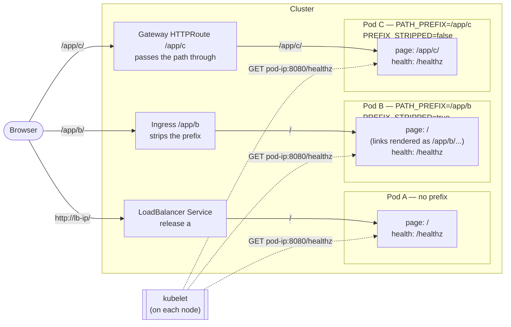
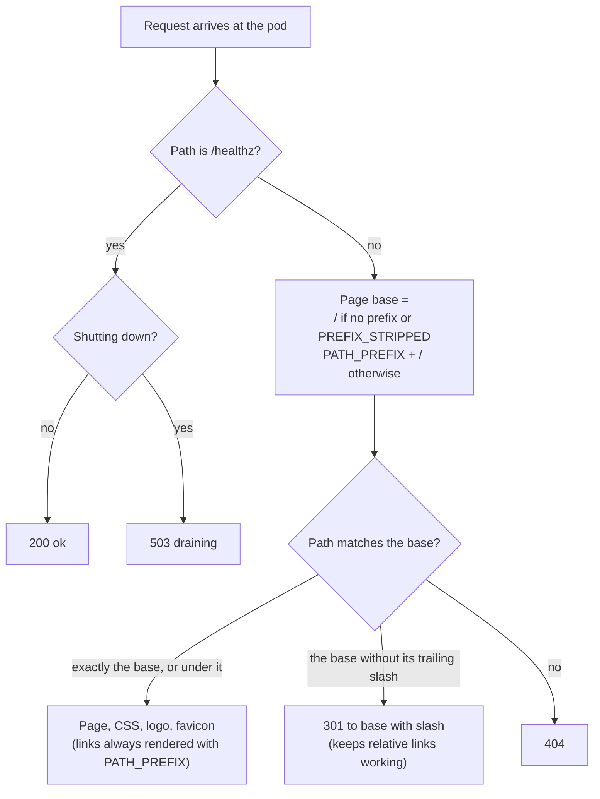

# 2.0: rewriting the app

A thought exercise for 2.0, not a plan of record. It takes the possible 2.0 goal in [GOAL.md](../../GOAL.md) as the new requirement: **support more architectures (at least `linux/arm/v7` and `linux/riscv64`) by rewriting the app in Go or Rust, without changing what it does.** It asks what we'd build if we started from scratch with that requirement, how the change ripples through the planning notes, and how to deliver it in stages.

Nothing here is implemented. Open decisions are listed at the end.

## Where the current design comes from

The app is an 81-line Express server with five npm dependencies. It renders one handlebars page and reads its architecture from a hard-coded `info.json`. It loads its font from Google Fonts, and it runs under `npm start`, so npm sits between Kubernetes and the app when the pod is stopped.

Almost every constraint in the planning notes comes from Node, not from the app:

- the architecture limits (no Node 24 build for arm/v7, only an unofficial one for riscv64)
- Node and Alpine end-of-life dates
- the eMudhra certificate exposure
- npm dependency churn
- distroless needing a special Node image
- the riscv64 workarounds.

The chart, the e2e tests and the operations model are mostly independent of the language.

## What we'd build from scratch

### Language: Go, standard library only

Rust would also work, but Go wins on the things this project cares about:

- **Cross-compiling** is an environment variable (`GOARCH=arm GOARM=7`, `GOARCH=riscv64`), with no extra toolchains, QEMU or unofficial builds. Rust needs a cross-toolchain per target.
- **Zero dependencies.** Go's standard HTTP server, HTML templates (with automatic escaping), file embedding and JSON logging (`slog`) cover everything. A Rust web server pulls in roughly a hundred crates for Dependabot to churn through.
- **Audience.** Kubernetes users and contributors mostly know Go.

### Design

| Part | 1.x (Node) | 2.0 |
|---|---|---|
| Server | Express + handlebars | Go standard HTTP server and HTML templates. Escaping is built in, which settles the E3 message-escaping test |
| Static files | `static/` copied into the image | CSS, logo and favicon embedded in the binary |
| Font | Google Fonts at runtime | System font stack or an embedded font. The page works on offline and air-gapped clusters and makes no outside requests |
| Architecture shown | `info.json` (hard-coded; CI to overwrite) | Read from the running binary (`runtime.GOARCH`, plus the ARM variant from Go's build info). Can't be wrong, so `info.json` goes away |
| Version | `package.json` | Set at build time |
| Logging | pino JSON with numeric levels | `slog` JSON, honouring `LOG_LEVEL`. Field names and level format change: a breaking change for anyone parsing logs |
| Shutdown | npm in front of node; signals handled badly | Handles SIGTERM and finishes in-flight requests (see [Health endpoint](#health-endpoint)) |
| Image | ~150 MB, Node + Alpine | ~5–10 MB, binary only, on `gcr.io/distroless/static-debian13`, which publishes all six Linux architectures. No OS packages to patch |
| Build | `npm install` in the image | A Dockerfile that cross-compiles on the build machine for each target; no QEMU in the build |
| User | `node`, later UID 1000 | UID 1000, so the chart's `securityContext` doesn't change |
| Debugging | Shell available in the Alpine image | No shell; `kubectl debug` (see [image.md](../1.x/image.md)) |

### Configuration contract

Two settings replace the two prefix variables, and match the chart's values exactly:

| Variable | Meaning | Chart value |
|---|---|---|
| `PATH_PREFIX` | Where the page lives in the browser, e.g. `/app/hello` | `pathPrefix` |
| `PREFIX_STRIPPED` | Whether the proxy removes the prefix before the request reaches the pod | `rewritePath` |

`HANDLER_PATH_PREFIX` and `RENDER_PATH_PREFIX` stay as deprecated aliases throughout 2.x, since tutorials set them with `docker run`. The app logs a warning when it sees them.

Unchanged: `MESSAGE`, `PORT`, `LOG_LEVEL`, `KUBERNETES_NAMESPACE`, `KUBERNETES_POD_NAME`, `KUBERNETES_NODE_NAME`, `CONTAINER_IMAGE`.

Two problems disappear by design:

- **#38 (asset paths):** the page builds every link from one normalised prefix.
- **The relative-link trap:** a request for the base path without its trailing slash (e.g. `/app/hello`) redirects to `/app/hello/`.

## Health endpoint

**Proposed, not yet in scope.** [GOAL.md](../../GOAL.md) lists health endpoints as out of scope unless proposed. This is the proposal: it isn't a user-facing feature, and it removes a class of bug.

### Why it doesn't need the prefix

Kubernetes probes come from the **kubelet**, the agent on each node, and go **directly to the pod's IP and port**. They never pass through the Service, Ingress or Gateway. The path prefix only exists at the proxy level: it's how the Ingress or Gateway routes `/app/b/...` to the right release. Probes never see it.

The prefix only becomes the pod's concern when the proxy *doesn't* strip it (`rewritePath: false`). Then the app serves its page under `/app/c/`, and today the probes have to follow it there. That's the bug behind #30 and #44: the chart sent probes to `/` while the page lived at `/app/c/`, so the probes failed and the pods never became ready.

A `/healthz` that always answers at the root, whatever the prefix settings, means the probe path is the same in every configuration. The chart no longer has to calculate it, and that bug can't come back.

### Three pods, three configurations

User traffic (solid lines) takes three different routes, and only pod C sees the prefix. The probes (dotted lines) are identical for all three. Today, pod C would need its probes pointed at `/app/c/`; with `/healthz`, the chart sets the same probe for every release.

### How the app decides what to serve

### What it reports

Very little, by design:

- **`200 ok`** (plain text) whenever the process is up and serving. The app has no database or other dependencies, so "the process answers HTTP" is the whole health check. The page template and embedded files load at startup, and the app refuses to start if they're broken, so it can't be running but unable to show the page.
- **`503 draining`** after the pod receives SIGTERM, for a few seconds while in-flight requests finish. Kubernetes already stops sending new traffic to terminating pods, so this mainly serves as a clear signal in logs and tests. The short delay before shutting down is what makes E12's zero-downtime upgrade test reliable.
- **No configuration.** Returning the prefix or settings would make it a JSON metadata endpoint, which [GOAL.md](../../GOAL.md) puts out of scope. The app logs its configuration at startup instead: `kubectl logs` shows each pod's settings, and the page itself shows where the pod is running.

The same endpoint serves for both liveness and readiness. With no dependencies, there's nothing that could make the app alive but not ready.

### What it gives up

Today's page-based probe in pod C does check one extra thing: that the app serves the page at the prefix it was given. But because probes skip the proxy, they never checked the part that usually goes wrong, which is the Ingress or Gateway routing. Unit tests cover the app serving at its prefix, and E6/E17 in [testing.md](../1.x/testing.md) cover the full path through the proxy. The trade-off is small, and it removes a class of probe misconfiguration.

**Exposure:** in configuration B, `/app/b/healthz` is reachable from outside, because the proxy strips the prefix and passes `/healthz` through. That's harmless, since it reveals nothing.

## Architectures

Building more platforms costs almost nothing in Go; the real cost is testing them. Each platform has to earn its place, the same test applied to labels in [operations.md](../1.x/operations.md).

| Platform | Why | How it's tested |
|---|---|---|
| amd64, arm64 | Most users | kind and k3d on native CI runners |
| arm/v7 | 32-bit Raspberry Pi OS users (#16, #46) | QEMU smoke test in CI, plus a manual check on a Pi before release |
| riscv64 | #46 | QEMU smoke test |
| ppc64le, s390x | No demand | Out of scope. Free to add later if someone asks |
| Windows | — | Still out. Windows images need Windows base images and build hosts; it's now a choice, not a runtime limitation |

## Changes to every file

| File | What changes |
|---|---|
| [GOAL.md](../../GOAL.md) | The architecture list becomes amd64, arm64, arm/v7, riscv64, and the reason changes from "official Node images" to "platforms we can build and test". The "Possible 2.0 goal" section becomes the current scope. The `info.json` requirement is replaced by "detected from the running binary". Environment variables updated; `/healthz` only if approved. |
| [image.md](../1.x/image.md) | The biggest rewrite: - **Runtime:** "Node, not Bun" becomes "Go, not Rust". - **Base image:** the Node-alpine/distroless-Node comparison becomes distroless static. - **Obsolete sections:** the npm dependency upgrades and `package-lock.json`. - **Debugging:** `kubectl debug` stays, without the "do it in a major version" caveat. - **Architectures:** the table gains the static base image, and the `info.json` and 2.0 sections become the current plan. - **Scanning:** Trivy now scans the Go binary's modules and Go version; add `govulncheck`, which reports only vulnerabilities the code can actually reach. The Trivy installation advice stays. The new maintenance task is rebuilding on Go patch releases. |
| [deploy.md](../1.x/deploy.md) | Mostly unchanged, which shows the chart was designed independently of the app. Changes: - **Environment variables:** the mapping to `PATH_PREFIX`/`PREFIX_STRIPPED`. - **Probes:** move to `/healthz` if approved; the rows about probes following the prefix go. - **Resource requests:** smaller defaults (roughly 10m CPU and 16Mi memory). - **Values table:** updated for the above. |
| [testing.md](../1.x/testing.md) | **Image tests:** - I1 checks the Go version instead of Node's. - I2 (Alpine CA bundle) becomes "the image contains only the binary". - I3 can't run `id` in the image, so it uses `docker inspect` only. - I5 adds arm/v7 and riscv64 under QEMU.  **E2e tests:** E7 checks the pod spec instead of `kubectl exec`. E6/E17 check probes use `/healthz` if approved.  **New layer: unit tests** (`go test`) for escaping, prefix handling, environment aliases, redirects and `/healthz`. Cheap in Go, and missing today. |
| [site.md](../1.x/site.md) | **Live preview:** the browser can't run Go templates. Instead, CI runs the real image with sample settings and saves the page, and the builder swaps in the message, so the preview still uses real output. **Rationale:** "Astro is Node, like the app" no longer applies. Hugo's "Go templates, like Helm" gets a little stronger, but Starlight still wins on product feel. |
| [operations.md](../1.x/operations.md) | Labeler paths for `area:app` and `area:image` if the folder layout changes. Dependabot `gomod` instead of `npm`, which will rarely open PRs. |
| [community.md](../1.x/community.md) | **#46:** arm/v7 and riscv64 arrive in 2.0; credit @chazapis then. **#16:** 32-bit Pi users get images. **#40:** detecting the architecture when the app runs turns out to be the right call. **#38:** fixed by design. |
| [review.md](../1.x/review.md) | Its Node and Alpine findings no longer apply in 2.x. Keep it as the history for 1.x. |
| Repo | **App and build:** `src/app/` becomes `go.mod`, `main.go` and `templates/`, keeping the folder path to reduce knock-on edits. Rewrite the Dockerfile and Makefile targets. **Dev setup and workflows:** the devcontainer moves to a Go image; workflows use `setup-go`. **Docs:** update the README, `src/app/README.md`, `docs/build-and-push-container-images.md`, `docs/development-environment.md` and the planned `AGENTS.md` (`go test`, `go vet`, `govulncheck`). |

### A 1.x bug found along the way

`values.yaml` sets the default `nodeSelector` to `kubernetes.io/arch: amd64`. Once arm64 images ship in 1.x, pods would still never be scheduled on arm64 nodes. Fix this in 1.x: keep only `kubernetes.io/os: linux`. None of the 1.x notes mention it yet.

## Delivering it in stages

The e2e and image tests in [testing.md](../1.x/testing.md) are black-box: they only use HTTP and Kubernetes. Written first, they become the parity suite that proves the Go rewrite behaves the same.

0. **In 1.x, now:** build what makes 2.0 a drop-in replacement.
   - The e2e suite, with the image under test as a parameter.
   - A written behaviour contract in `src/app/README.md`: page fields, environment variables, paths, prefix behaviour, escaping.
   - The non-breaking chart additions (`ingress.enabled`, `httpRoute`).
   - The `nodeSelector` fix.
1. **Go app reaching parity:** on a branch, amd64/arm64 only, passing the same suite. CI runs the suite against both images. Publish `2.0.0-rc` tags so people can try it.
2. **New architectures:** arm/v7 and riscv64, with QEMU smoke tests and a check on a Pi.
3. **Release 2.0.0 with all breaking changes together:**
   - log format
   - the font
   - environment variable aliases (deprecated)
   - the `rewritePath` default and value moves from [deploy.md](../1.x/deploy.md)
   - `/healthz`, if approved.

   One major release with one migration guide is kinder to users than two. That means the breaking chart changes in `deploy.md` would wait for 2.0, while 1.x gets only the additions. The `:1` tag stays on the last 1.x release, and 1.x gets security rebuilds for a stated period (for example six months), then stops.
4. **Clean-up:** remove the Node code, the npm Dependabot entries and the Node-specific sections of the notes.

## Risks

- **Small behaviour differences** from Express: trailing slashes, 404 pages, HEAD requests, caching headers. The parity suite should cover these.
- **Go security releases** come regularly, so 2.x still needs rebuilds. They're less frequent than npm and OS patches, and Dependabot's docker and gomod updates cover them.
- **QEMU tests are slow.** Run them on release tags and nightly, not on every PR.
- **Losing the shell.** No evidence was found that anyone relies on it, and `kubectl debug` replaces it.
- **Log parsers.** Anyone parsing pino's numeric levels breaks; the migration guide must show the old and new formats.

## Open decisions

1. Go over Rust.
2. Whether to add `/healthz` to the scope in [GOAL.md](../../GOAL.md).
3. Whether to hold the breaking chart changes for 2.0, so there's one migration.
4. arm/v7 and riscv64 in, ppc64le and s390x out.
5. How long 1.x keeps getting security rebuilds after 2.0.
