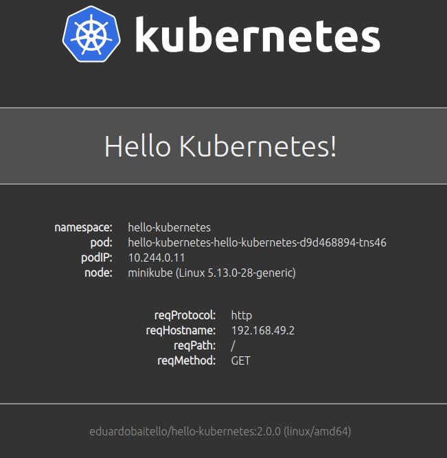

# Hello Kubernetes!

[](https://hub.docker.com/r/paulbouwer/hello-kubernetes) [](https://hub.docker.com/r/paulbouwer/hello-kubernetes) [](https://hub.docker.com/r/paulbouwer/hello-kubernetes) [](https://artifacthub.io/packages/search?repo=hello-kubernetes)

hello-kubernetes is a small web app to deploy on a Kubernetes cluster. Its page shows:

- a message, **Hello world!** by default
- the namespace, pod and node it runs on
- the container image and its architecture



The image runs on `linux/amd64` and `linux/arm64` nodes, as a non-root user. It is on Docker Hub as `paulbouwer/hello-kubernetes` and on GHCR as `ghcr.io/paulbouwer/hello-kubernetes`.

## Quick start

Choose one of these. None of them needs a copy of this repo.

| | Needs | Installs into | You get |
|---|---|---|---|
| [1. kubectl](#1-kubectl-the-release-file) | `kubectl` | your current namespace, usually `default` | the app with its default settings |
| [2. Helm](#2-helm-the-chart) | `kubectl` and [Helm 4](https://helm.sh/docs/intro/install/) | your current namespace, usually `default` | the app with its default settings, which you can change and upgrade |
| [3. Helm, your own message](#3-helm-your-own-message-in-its-own-namespace) | `kubectl` and Helm 4 | a new `hello` namespace | the app with your message |

Each one creates a `LoadBalancer` Service, which gives the app an external address on most clusters. See [Where the external address works](#where-the-external-address-works) before you start.

### 1. kubectl: the release file

Each release has `hello-kubernetes.yaml`: the Helm chart rendered with its default values. Apply it to your current namespace:

```bash
kubectl apply -f https://github.com/paulbouwer/hello-kubernetes/releases/latest/download/hello-kubernetes.yaml
kubectl rollout status deployment/hello-kubernetes-demo
```

You see `deployment "hello-kubernetes-demo" successfully rolled out`. It created a ServiceAccount, a Service and a Deployment with 2 pods, all named `hello-kubernetes-demo`.

Get the external address. It can take a minute to appear:

```bash
kubectl get service hello-kubernetes-demo
```

Open `http://<EXTERNAL-IP>/`. You see **Hello world!**. If `EXTERNAL-IP` stays `<pending>`, use `kubectl port-forward service/hello-kubernetes-demo 8080:80`, then open `http://localhost:8080/`.

Remove it:

```bash
kubectl delete -f https://github.com/paulbouwer/hello-kubernetes/releases/latest/download/hello-kubernetes.yaml
```

To change its settings without Helm, for example with Kustomize, see [Deploy using kubectl and Kustomize](docs/deploy-using-kubectl-and-kustomize.md).

### 2. Helm: the chart

The chart is published on GHCR as an OCI artifact. Install it with its default values, as the release `demo`, in your current namespace:

```bash
helm install demo oci://ghcr.io/paulbouwer/charts/hello-kubernetes --wait
```

You see `STATUS: deployed`, and notes that say how to reach the app. Get the external address:

```bash
kubectl get service hello-kubernetes-demo
```

Open `http://<EXTERNAL-IP>/`. You see **Hello world!**. If `EXTERNAL-IP` stays `<pending>`, use `kubectl port-forward service/hello-kubernetes-demo 8080:80`, then open `http://localhost:8080/`.

Remove it:

```bash
helm uninstall demo
```

### 3. Helm: your own message, in its own namespace

Install the chart as the release `custom-message`, in a new `hello` namespace, with your own message:

```bash
helm install custom-message oci://ghcr.io/paulbouwer/charts/hello-kubernetes \
  --namespace hello --create-namespace \
  --set-string message="I just deployed this on Kubernetes!" \
  --wait
kubectl get service hello-kubernetes-custom-message --namespace hello
```

Open `http://<EXTERNAL-IP>/`. You see **I just deployed this on Kubernetes!**. Use `--set-string` for the message, so Helm keeps it as text even if it looks like a number or `yes`.

Remove it, and the namespace:

```bash
helm uninstall custom-message --namespace hello
kubectl delete namespace hello
```

### Where the external address works

| Cluster | `LoadBalancer` Service |
|---|---|
| Cloud clusters, such as EKS, GKE and AKS | Works. You get a public address, and your cloud may charge for the load balancer. |
| Docker Desktop, OrbStack | Works. The address is `localhost`. |
| k3s, k3d, Rancher Desktop | `EXTERNAL-IP` stays `<pending>`, because their built-in Traefik already uses port 80. Use `kubectl port-forward`. With Helm, `--set service.port=8080` gives the app its own address on port 8080; with k3d, also create the cluster with `-p "8080:8080@loadbalancer"`, and open `http://localhost:8080/`. |
| kind, minikube, bare metal | `EXTERNAL-IP` stays `<pending>`. The app still runs: use `kubectl port-forward`. minikube also has `minikube tunnel`, and kind has `cloud-provider-kind`. |

The default Service type is `LoadBalancer` in 1.x. With Helm, `--set service.type=ClusterIP` gives the app no external address: reach it with `kubectl port-forward`, or through an Ingress or a Gateway.

## Documentation

- [Deploy using Helm](docs/deploy-using-helm.md): all the chart values, pinning a version, upgrading, and checking the chart's signature.
- [Deploy with an Ingress or a Gateway](docs/deploy-with-ingress.md): serve the app under a path such as `/app/hello`, with NGINX, Traefik or the Gateway API.
- [Deploy using kubectl and Kustomize](docs/deploy-using-kubectl-and-kustomize.md): the release file, and changing it without Helm.
- [Build and push container images](docs/build-and-push-container-images.md): build the image yourself, and check a published image.
- [Development environment](docs/development-environment.md): the dev container with all the tools at known versions.
